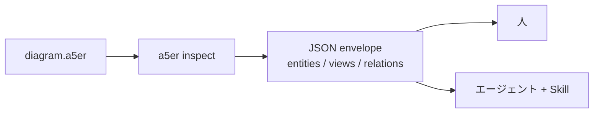

チームで開発していると、人によって使うOSが違う。[A5:SQL Mk-2](https://a5m2.mmatsubara.com/)はWindows用のソフトで、自分はMacで開発しているので、ER図を確認するたびに仮想マシンのWindowsを起動して開いていた。ちょっとした確認のために重いVMを上げるのが面倒で、エージェントに読ませる手段もなかった。そこで`.a5er`をエージェントが読める形式に変換するCLIと、その使い方を固定するSkillを作った。

## この記事で分かること

- `a5er-cli` v0.1.2で何ができるか。`inspect`と`validate`の使い分けと終了コード
- JSON envelopeの読み順。`status`から`schema`まで、どこを先に見るか
- あえて作らなかった`tables`コマンドと、推測しない設計の話
- npm・mise・チェックアウトからの導入手順と、正直な検証範囲

## 1ファイルから1JSONを読む仕組み

`a5er`はA5:SQL Mk-2のER図ファイル(`.a5er`)を1つ受け取り、JSONのenvelopeを1つだけ標準出力に書く読み取り専用CLIだ。入力ファイルは変更しない。npmパッケージは`@j1nn0/a5er-cli`で、実行ファイル名は`a5er`、Node.js 24以上が必要だ。



使い方は2コマンドだけだ。

```bash
a5er inspect diagram.a5er   # 中身を読む
a5er validate diagram.a5er  # 同じenvelopeを出し、errorがあれば終了コード3で知らせる
a5er --help                 # 使い方
a5er --version              # バージョン
```

`--format json`は受け付けるが、出力はJSONだけで選べない。これ以外の単語、たとえば`tables`や`export`を渡すと終了コード2で使い方を標準エラーに出し、標準出力には何も書かない。

終了コードの意味は次のとおりだ。

| 終了コード | 意味 |
| --- | --- |
| `0` | envelopeを書いた。`inspect`は`failed`でなければ0、`validate`は`error`診断がなければ0 |
| `1` | `fatal`診断。envelopeは`failed`だが、それ自体は正しいJSON |
| `2` | 使い方の誤り。標準出力は空で、標準エラーに使い方 |
| `3` | `validate`のみ。`error`以上の診断がある |

`inspect`は決して3を返さない。`inspect`は中身を報告し、`validate`が許容できるかどうかを判定する。`inspect`で`error`が見つかっても終了コードは0のまま、標準エラーに1行ずつ出る。

## envelopeはstatusから読む

すべてのenvelopeは同じ10キーを持つ。`contractVersion`、`tool`、`command`、`status`、`source`、`limits`、`schema`、`unsupported`、`diagnostics`、`completeness`だ。`status`は`ok`、`degraded`(読めたが所見あり)、`failed`のいずれかだ。`failed`のとき`source`と`schema`と`completeness`は`null`になる。`contractVersion`はパッケージのバージョンとは独立に付けている。

読む順番はSkillに固定してある。JSON全体をエージェントに見せず、必要なところだけ抜き出す方針だ。

1. **`status`** を見る。`failed`なら内容の質問には答えず、`diagnostics[0]`のコードとメッセージだけ返す
2. **`unsupported`** と **`completeness`** を見る。`ok`でも`unsupported`が空とは限らない。解釈しなかったもの(`unknown-key`や`subtype-membership`など)は原文のまま残す。数えた行数(`dropped`が0より大きければ行の見落とし)も言う
3. **`diagnostics`** を見る。ファイル内の行順に並んでいる。`fatal`と`error`の報告を先にするのは表示の工夫だ。位置を言うときはenvelopeの順序を使う
4. **`schema`** を読む。`objects[]`の`kind`は`entity`、`view`、`subtype`のいずれかだ。`fields[]`を持つのは`entity`だけで、`view`は列を持たない。`subtype`の所属情報は仕様にキーがないため、常に未対応として扱う

大きなファイルだとenvelopeは数十KBになるので、全部を表示せずに抜き出す。READMEに載っている定番の抜き出し方はこれだ。終了コードを保ったまま一時ディレクトリを消すため、サブシェルと`trap`で囲む。

```bash
file=diagram.a5er   # 自分のファイルに置き換える
(
  tmp=$(mktemp -d) || exit 70
  trap 'rm -rf "$tmp"' EXIT
  a5er validate "$file" >"$tmp/out.json" 2>"$tmp/err.txt"; code=$?
  echo "exit=$code"; cat "$tmp/err.txt"
  if [ "$code" -ne 2 ]; then
    node -e 'const j=JSON.parse(require("fs").readFileSync(process.argv[1],"utf8"));
console.log(j.status,"unsupported="+j.unsupported.length,JSON.stringify(j.completeness));
for(const d of j.diagnostics)console.log(d.severity,d.code,d.span?"line "+d.span.startLine:"")' "$tmp/out.json"
  fi
  exit "$code"
)
```

標準出力に混ぜるのはJSONと最後の改行だけ、診断の文章は標準エラーに分けた。`2>&1`で混ぜるとJSONとして読めなくなるのでやらない。

機密の話でもある。envelopeはファイルの名前やコメントや原文をそのまま含む。実物の`.a5er`から作ったenvelopeはリポジトリの外に置き、使い終わったら消す。`.a5er`自体はgitignoreしている。検証に使うのは合成したfixtureだけだ。

## 作らなかったもの：tablesコマンド

一覧がほしいなら`a5er tables`のような薄い派生コマンドが要りそうに見える。検討した結果、作らないことにした。`inspect`の出力をSkill側の手順でNode.jsを使って絞るだけで同じ効果が出るし、JSON契約に手を入れずに済むからだ。

新しいコマンドを足すと、全コマンド共通のenvelopeという規約との整合を考え直す必要が出る。CLIを変えずにSkillの手順として足すほうが保守の負担が小さく、既存のテストにも触らない。`tables`は将来、CLI利用者から一覧取得の需要が出た段階で考え直す候補として残している。

## 推測しない：分からないものは分からないまま残す

このCLIで一番こだわったのは、読み取れなかった定義を存在しないことのように扱わない点だ。仕様にない項目は捨てず、`unsupported`に原文と位置付きで残す。値の出所(`declared`か`defaulted`か、推論した`inferred`か)も落とさない。欠けた名前を空文字列で埋めたり、同名オブジェクトを重複排除したりもしない。エージェントがもっともらしい回答を作る余地をできるだけ小さくしている。

## 使い始め方：インストールからSkill導入まで

パッケージは公開済みで、`latest`は0.1.2だ(執筆時点)。

```bash
npm install -g @j1nn0/a5er-cli
```

```bash
mise use -g 'npm:@j1nn0/a5er-cli'
```

ソースから使うなら、pnpmでビルドして`node dist/cli.js`を`a5er`の代わりに使う。

```bash
git clone https://github.com/j1nn0/a5er-cli.git
cd a5er-cli
pnpm install --frozen-lockfile
pnpm build
node dist/cli.js --version
```

Skillの導入は別だ。Skillは`a5er`を呼び出すだけで、同梱しない。

```bash
npx skills@latest add j1nn0/a5er-cli -s a5er-cli
```

Skillを使う前の前提確認は2つだけ。`node --version`がv24以上であることと、`command -v a5er`がパスを返すことだ。`a5er`がなければ分析を始めず、ファイルの中身を推測で読んだりもしない。ここはSkillに明記してある。

正直に書くと、検証の範囲はまだ狭い。READMEに書いているとおり、公開レジストリとtarballからの導入確認と、macOS arm64でのmise導入確認はv0.1.0時点のもので、それ以降のバージョンや他の環境は個別に検証していない。

出たばかりのリリースが`latest`として引けないときは、`npm:@j1nn0/a5er-cli@X.Y.Z`のように版を固定する。

## 人間向けの読みやすい出力は今後の追加機能

今はエージェントが使うことを優先している。人間がmacやLinuxで読むための、ファイルやターミナルで読みやすい出力は今後の追加機能として考えている。基本機能はv0.1.2でそろったので、まずは使ってみてほしい。

役に立つものはここに置いてある。ソースとドキュメントは[リポジトリ](https://github.com/j1nn0/a5er-cli)に、配布物は[npmの`@j1nn0/a5er-cli`](https://www.npmjs.com/package/@j1nn0/a5er-cli)にある。仕様の一次情報は[A5:SQL Mk-2のER図ファイル仕様](https://a5m2.mmatsubara.com/document/v2.21/a5er_specification.html)だ。

不具合や要望は[Issues](https://github.com/j1nn0/a5er-cli/issues)へどうぞ。
